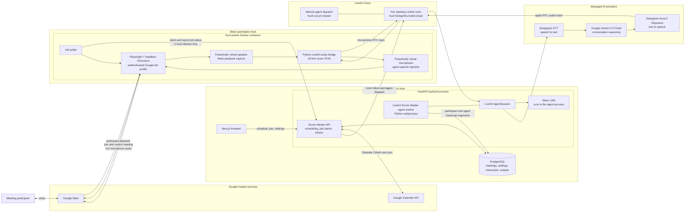

# Scrum Master voice architecture

This document describes the current Huzlr Scrum Master meeting architecture. It
separates the job-control path from the real-time audio path because they run in
different processes and use different credentials.

## Current runtime architecture

## Where each component runs

| Component | Current location | Responsibility |
| --- | --- | --- |
| Next.js frontend | Huzlr web application | Calendar connection, meeting list, manual join, scheduling, and status UI. |
| FastAPI Scrum Master API | `huzlr-be` application process | Stores meeting state, exposes the worker job API, creates LiveKit room tokens, and requests named-agent dispatch. |
| Scrum Master voice agent | Python subprocess started by the FastAPI lifespan | Connects to the LiveKit room and runs the conversational voice pipeline. It is not running on the Meet worker and is not hosted by the LiveKit server. |
| Playwright automation | `huzl-worker` Docker container | Launches authenticated headless Chromium and joins Google Meet as the dedicated bot account. |
| Audio bridge | Same `huzl-worker` container | Publishes Meet playback to LiveKit and writes returned agent audio into Chromium's virtual microphone. |
| LiveKit server | LiveKit Cloud at `wss://huzl-hdzkgm0u.livekit.cloud` | Hosts the per-meeting RTC room and dispatches the named Scrum Master agent. It transports audio; it does not run Gemini, STT, or TTS itself. |
| PostgreSQL | Database configured by `DATABASE_URL` | Persists meetings, policies, encrypted Calendar credentials, transcript segments, summaries, and proposed action items. |
| Google Meet and Calendar | Google-hosted services | Provides the actual meeting and optional event import/synchronization. |

## Voice model stack

| Stage | Implementation | Execution location |
| --- | --- | --- |
| Voice activity detection | Silero VAD | Loaded locally inside the Scrum Master agent process. |
| Speech recognition | `deepgram.STT()` | Deepgram managed API; the current code does not pin a specific STT model name. |
| Conversation model | Gemini 2.5 Flash | Google managed API via `google.LLM(model="gemini-2.5-flash")`. |
| Speech synthesis | Deepgram Aura-2, Odysseus voice | Deepgram managed API via `deepgram/aura-2:odysseus`. |
| Post-meeting output generation | Gemini 2.5 Flash | Backend output service, after the meeting when configured. |

## End-to-end voice flow

1. The Docker worker claims a due or manually requested meeting job from FastAPI.
2. FastAPI creates a per-meeting LiveKit token and dispatches the named
   `huzlr-scrum-master` agent.
3. Playwright opens Google Meet using the mounted bot authentication state.
4. Participant audio plays through Chromium into the PulseAudio virtual speaker.
5. The worker captures that playback as 16 kHz mono PCM and publishes it to LiveKit
   as a microphone track.
6. The backend agent applies Silero VAD, sends speech to Deepgram STT, sends the
   transcript to Gemini 2.5 Flash, and sends the response to Deepgram TTS.
7. LiveKit returns the synthesized audio track to the Docker bridge.
8. The bridge writes that audio into the virtual microphone used by Chromium, so
   Google Meet participants hear the response.
9. Final participant and agent conversation items are persisted to PostgreSQL.

## Production separation

The development backend starts the voice agent as a subprocess. For production,
deploy the FastAPI API, Scrum Master agent worker, Meet automation worker, and
PostgreSQL as independently supervised services. Run exactly one Meet worker per
mounted Google bot profile, while multiple agent workers may register with the same
LiveKit project for horizontal scaling.
