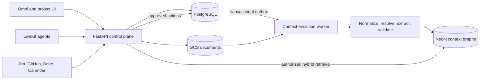

# Project Context Graph Implementation Plan

**Status:** Baseline implemented; deployment and staged rollout pending
**Scope:** Huzlr web application, FastAPI backend, persistent agent workers, and integrations
**Primary graph database:** Neo4j
**Operational source of truth:** PostgreSQL
**Last updated:** 2026-09-06

## 1. Executive summary

Huzlr will maintain a logically isolated, continuously evolving context graph for every project. The graph will connect structured project-management data with knowledge extracted from documents, conversations, meetings, and external systems. An authorized agent session will be able to attach one or more project graphs, retrieve relevant evidence, reason across their relationships, and propose or perform work through controlled tools.

Neo4j will be the authoritative store for derived project context, relationships, semantic claims, and graph retrieval. PostgreSQL will remain authoritative for operational records such as workspaces, teams, projects, issues, milestones, documents, meetings, permissions, and audit records. GCS will continue to store original document bodies.

The graph will be self-evolving through an event-driven ingestion pipeline. New information will first be recorded as immutable evidence, then normalized, resolved against existing entities, converted into candidate claims, validated under a trust policy, and finally applied to Neo4j. Agent-generated statements will not automatically become facts. Every derived fact must retain provenance and be reversible.

The recommended first production slice is:

> Select two authorized projects in Omni, ask for shared blockers and dependencies, receive an evidence-cited answer, then preview and confirm the creation of an issue in one selected project.

## 2. Goals

1. Create one logical knowledge graph for each Huzlr project.
2. Allow an agent session to attach multiple authorized project graphs.
3. Continuously ingest information from users, documents, meetings, Huzlr mutations, and connected systems.
4. Preserve the source, confidence, time range, and history of every derived fact.
5. Support graph traversal, semantic search, keyword search, and structured filtering.
6. Give text and voice agents a common context and tool layer.
7. Allow agents to perform work safely through preview, confirmation, authorization, idempotency, and auditing.
8. Prevent cross-workspace and unauthorized cross-project data exposure.
9. Make the graph completely rebuildable from authoritative data and immutable source events.

## 3. Non-goals

1. Replacing PostgreSQL with Neo4j for application CRUD.
2. Treating all conversation content as permanent knowledge.
3. Allowing an LLM to execute arbitrary Cypher or mutate the graph directly.
4. Training or fine-tuning a foundation model in the first release.
5. Automatically merging ambiguous people, projects, or work items.
6. Building every external connector before the core graph and retrieval path is proven.
7. Providing unrestricted autonomous write access to project-management systems.

## 4. Current-state assessment

Huzlr already contains much of the authoritative structure required to seed a project graph:

- Workspaces contain teams, and teams contain projects.
- Projects own issues, milestones, documents, risks, assumptions, conversation logs, inputs, and versions.
- Issues support subtasks and issue-to-issue dependencies.
- Project documents are stored in PostgreSQL or GCS.
- Scrum meetings produce transcripts and derived summaries, decisions, blockers, and action items.
- Persistent LiveKit workers already call a protected internal agent API.

The main gaps are:

- No graph database or graph synchronization pipeline.
- No embeddings, semantic chunks, entity resolution, or hybrid retrieval service.
- Internal agent endpoints expose shallow lists rather than evidence-rich context.
- Omni currently sends chat history directly to the model without project context.
- Project voice sessions do not identify the current project in dispatch metadata.
- Scrum meetings are workspace-scoped and cannot yet be associated with one or more projects.
- Jira project import is not yet a production connector and uses mocked project discovery.
- Agent-service authentication identifies the service but does not provide a strong delegated user-and-project authorization token.
- Existing mutation logic is distributed across API endpoints, so reliable graph updates require an outbox and reconciliation process.

## 5. Architecture decisions

### 5.1 Storage responsibilities

| System | Responsibility |
| --- | --- |
| PostgreSQL | Operational entities, tenancy, permissions, graph outbox, context sessions, connector cursors, action approvals, and audit records |
| Neo4j | Derived context nodes, relationships, claims, evidence projections, graph traversal, full-text indexes, and vector indexes |
| GCS | Original project-document bodies and potentially large immutable source artifacts |
| Context worker | Event consumption, document parsing, extraction, entity resolution, Neo4j synchronization, retries, and reconciliation |
| FastAPI | Authorization, context-session management, retrieval API, action policy, and agent-facing tools |
| LiveKit agents | Conversation orchestration; they consume tools but do not own graph data or authorization |

### 5.2 Logical isolation

A separate Neo4j database per project is not required. Each node and claim will include a `workspace_id`, and project-owned records will include a `project_id`. A project's logical graph is the subgraph reachable from its `Project` node within those scope constraints.

A multi-project session queries the union of explicitly selected and currently authorized project subgraphs. Workspace-level nodes such as a person or shared system can bridge projects, but access to such a node must not make an unauthorized project traversable.

### 5.3 System flow



### 5.4 Graphs versus agent workflows

Neo4j stores the knowledge graph. LangGraph may be used to orchestrate extraction, retrieval, validation, and action workflows, but it is not the graph database and must not become the source of truth.

## 6. Graph ontology

The ontology must begin small and stable. New labels and relationships should be added only when they support a defined retrieval or action use case.

### 6.1 Initial node labels

| Label | Purpose |
| --- | --- |
| `Workspace` | Organization and tenant boundary |
| `Team` | Team that owns or participates in work |
| `Project` | Root of a logical project graph |
| `Person` | User, team member, meeting participant, or external identity |
| `Issue` | Project issue, task, or subtask |
| `Milestone` | Project milestone or delivery phase |
| `Document` | Project document or external document |
| `DocumentChunk` | Searchable section with an embedding and source span |
| `Meeting` | Scrum or other project-related meeting |
| `TranscriptSegment` | Immutable meeting evidence when segment-level provenance is required |
| `Requirement` | Explicitly stated project requirement |
| `Decision` | Confirmed or proposed project decision |
| `Risk` | Known or inferred risk |
| `Assumption` | Explicit project assumption |
| `Blocker` | Condition blocking work |
| `ActionItem` | Proposed or confirmed work arising from a meeting or conversation |
| `System` | External service, repository, component, or dependency |
| `Claim` | Temporal, attributable assertion connecting entities or values |
| `SourceEvent` | Immutable evidence event projected from the event store |

### 6.2 Initial relationships

```text
(Workspace)-[:HAS_TEAM]->(Team)
(Team)-[:OWNS_PROJECT]->(Project)
(Project)-[:HAS_ISSUE]->(Issue)
(Project)-[:HAS_MILESTONE]->(Milestone)
(Project)-[:HAS_DOCUMENT]->(Document)
(Project)-[:HAS_MEETING]->(Meeting)
(Issue)-[:SUBTASK_OF]->(Issue)
(Issue)-[:DEPENDS_ON]->(Issue)
(Issue)-[:PART_OF]->(Milestone)
(Person)-[:OWNS]->(Issue|ActionItem)
(Issue|Project)-[:BLOCKED_BY]->(Blocker)
(Meeting)-[:PRODUCED]->(Decision|Blocker|ActionItem)
(Document|Meeting)-[:MENTIONS]->(Issue|Requirement|Risk|System)
(Decision)-[:AFFECTS]->(Project|Issue|Milestone)
(SourceEvent)-[:SUPPORTS]->(Claim)
(Claim)-[:SUBJECT]->(entity)
(Claim)-[:OBJECT]->(entity)
```

### 6.3 Required common properties

All project-owned graph records must include:

```text
workspace_id
project_id
canonical_id
source_system
source_entity_type
source_entity_id
created_at
updated_at
source_version
```

Claims additionally require:

```text
predicate
value_json or object canonical_id
status: proposed | active | disputed | superseded | retracted
confidence: 0.0-1.0
valid_from
valid_until
recorded_at
extractor_version
```

### 6.4 Canonical identity

Deterministic canonical IDs prevent duplicate graph nodes and make every write idempotent. Recommended formats are:

```text
huzlr:workspace:{workspace_id}
huzlr:project:{project_id}
huzlr:issue:{issue_id}
huzlr:document:{document_id}
jira:{cloud_id}:issue:{issue_key}
github:{installation_id}:repo:{owner}/{repo}
```

External identifiers must be stored in a source-mapping table in PostgreSQL. Labels, titles, and semantic similarity must never replace stable identifiers when one exists.

## 7. Self-evolution design

### 7.1 Memory tiers

#### Working memory

Short-lived agent-session state: selected projects, recent turns, current task, retrieved node IDs, and pending proposals. It expires unless deliberately promoted.

#### Episodic memory

Immutable evidence: user messages, meeting segments, connector events, document versions, tool calls, approvals, results, and corrections. It provides replay and audit history.

#### Semantic memory

Validated Neo4j knowledge: entities, relationships, claims, active project state, summaries, requirements, decisions, blockers, risks, and ownership.

### 7.2 Event contract

Every information-bearing interaction will emit a versioned event:

```json
{
  "event_id": "uuid",
  "event_type": "document.updated",
  "schema_version": 1,
  "workspace_id": 12,
  "project_ids": [42],
  "actor_type": "user",
  "actor_id": "81",
  "source_system": "huzlr",
  "source_entity_type": "project_document",
  "source_entity_id": "456",
  "source_version": "sha256-or-version",
  "occurred_at": "2026-09-06T10:00:00Z",
  "payload": {}
}
```

Events are inserted into a PostgreSQL outbox in the same transaction as the corresponding operational mutation. A worker may acknowledge an event only after its Neo4j transaction succeeds. Processing uses `event_id` and `source_version` for idempotency.

### 7.3 Evolution pipeline

1. **Authorize and scope:** Validate workspace and project associations when the source event is created.
2. **Persist evidence:** Store the immutable event and, where appropriate, the raw source artifact.
3. **Normalize:** Convert Huzlr and connector payloads into source-independent entity types.
4. **Resolve entities:** Match stable IDs first, then mappings, normalized names, and semantic candidates.
5. **Chunk and embed:** Parse documents or transcripts into meaningful source-linked chunks and generate embeddings.
6. **Extract candidate claims:** Use schema-constrained model output with quoted evidence spans, never free-form Cypher.
7. **Validate:** Enforce allowed labels, predicates, scopes, confidence thresholds, value types, and source policy.
8. **Detect conflicts:** Compare candidate claims against active claims without deleting prior evidence.
9. **Apply:** Upsert graph projections and move claims through their state transitions in one Neo4j transaction.
10. **Refresh derived views:** Recalculate project snapshots, materialized direct relationships, embeddings, and graph status.
11. **Record outcome:** Mark the event applied, ignored, awaiting review, or failed with a retryable reason.

### 7.4 Trust and promotion policy

| Source | Default treatment |
| --- | --- |
| Huzlr/PostgreSQL structured mutation | Automatically active |
| Verified external-system webhook or reconciliation result | Automatically active for fields owned by that system |
| Explicit user correction or confirmation | Active with user provenance |
| Explicit factual user statement | Active or high-confidence candidate according to predicate policy |
| Meeting statement | Proposed unless confirmed by an authorized participant or system update |
| Document extraction | Candidate with source span and confidence |
| Agent inference | Proposed and visibly marked as inferred |
| Agent-generated answer | Episodic record only; never evidence for a new fact |

Predicate policy must define which sources can authoritatively update fields. For example, Jira may own an imported issue's status while Huzlr owns its internal graph annotations.

### 7.5 Temporal changes and conflicts

- New information supersedes rather than deletes an earlier claim.
- Conflicting supported claims remain queryable and are marked `disputed`.
- Retrieval favors active, authoritative, recent claims while exposing material conflicts.
- A correction links to the claim it supersedes.
- `valid_from` and `valid_until` describe when a fact is true; `recorded_at` describes when Huzlr learned it.
- Deleted operational data creates tombstone events and removes active projections while retaining audit evidence according to retention policy.

### 7.6 Feedback loop

Every agent turn should record:

- Context session and selected project IDs
- User input
- Retrieved graph node, claim, and source IDs
- Generated response
- Tool proposals and executions
- Approval, rejection, correction, and final outcome

User corrections create high-priority evidence events. Approval of an action does not automatically validate every statement in the preceding answer; it validates only the approved action payload.

### 7.7 Maintenance loop

Scheduled jobs will:

- Reconcile Neo4j projections with PostgreSQL.
- Recover missed connector events using sync cursors.
- Detect and propose duplicate entity merges.
- Recalculate current project summaries and health indicators.
- Expire explicitly temporary claims.
- Refresh stale embeddings after content or model-version changes.
- Detect unsupported, orphaned, or contradictory active claims.
- Measure graph freshness and extraction quality.

Automated duplicate merging is permitted only for deterministic identifiers. Ambiguous merges require review.

## 8. Retrieval architecture

### 8.1 Context sessions

An `agent_context_session` binds:

```text
session_id
user_id
workspace_id
selected_project_ids
agent_type
created_at
expires_at
```

Selected projects are preferences, not an authorization snapshot. FastAPI must recheck current workspace and team memberships on every retrieval and action. A short-lived signed delegation token will carry the session ID to a LiveKit worker; it will not carry raw, trusted project permissions.

### 8.2 Hybrid retrieval flow

1. Resolve and authorize the requested context session.
2. Determine query intent and relevant entity types.
3. Apply workspace and authorized-project constraints before retrieval.
4. Run Neo4j vector search over document chunks and semantic nodes.
5. Run Neo4j full-text search and structured filters.
6. Traverse a bounded neighborhood from top candidates.
7. Rank by semantic relevance, graph relevance, source authority, recency, confidence, and diversity.
8. Build a token-budgeted context packet with evidence citations.
9. Return an explicit empty or insufficient-context result rather than inventing information.

### 8.3 Context packet

The model-facing response should be structured:

```json
{
  "scope": {
    "workspace_id": 12,
    "project_ids": [42, 43]
  },
  "facts": [],
  "relationships": [],
  "conflicts": [],
  "sources": [],
  "freshness": {},
  "truncated": false
}
```

Each fact and relationship references one or more source IDs. UI citations resolve those IDs to an authorized Huzlr page or external source.

### 8.4 Initial read tools

```text
search_project_context(query, project_ids, filters)
get_context_entity(canonical_id)
get_entity_neighbors(canonical_id, relationship_types, depth)
compare_projects(project_ids, dimensions)
find_cross_project_dependencies(project_ids)
get_context_sources(source_ids)
```

Agents receive bounded tools, not a general Cypher tool.

## 9. Controlled action architecture

Read and write capabilities must be separated. A write request follows:

```text
User intent
  -> construct typed action proposal
  -> authorize target project and action
  -> show exact preview
  -> explicit confirmation when required
  -> execute through operational service
  -> write audit and outbox records atomically
  -> evolve Neo4j from the resulting event
```

Every action requires:

- Acting user and target workspace/project
- Typed payload validated by the operational API
- Idempotency key
- Policy decision and, where required, approval ID
- Source agent/session/turn IDs
- Before-and-after audit information
- A tool result that distinguishes proposed, confirmed, completed, failed, and rolled back

The agent must never write directly to Neo4j to pretend operational work was completed.

## 10. API plan

Exact endpoint naming can follow existing API conventions, but the first contract should include:

```text
POST   /api/v1/context/sessions
GET    /api/v1/context/sessions/{session_id}
PUT    /api/v1/context/sessions/{session_id}/projects
POST   /api/v1/context/search
GET    /api/v1/context/entities/{canonical_id}
POST   /api/v1/context/entities/{canonical_id}/neighbors
GET    /api/v1/projects/{project_id}/context/status
POST   /api/v1/projects/{project_id}/context/reindex
GET    /api/v1/projects/{project_id}/context/conflicts
POST   /api/v1/agent-actions/proposals
POST   /api/v1/agent-actions/{proposal_id}/confirm
```

Internal worker APIs should use separate credentials and accept event/job identifiers rather than an arbitrary user ID. Reindexing and conflict-review endpoints require appropriate project or workspace administration roles.

## 11. PostgreSQL additions

Recommended tables:

| Table | Purpose |
| --- | --- |
| `context_outbox_events` | Transactional source events awaiting graph processing |
| `context_processing_attempts` | Retry history, errors, model version, and timings |
| `context_source_mappings` | Huzlr and external IDs to canonical graph IDs |
| `context_sessions` | User, workspace, agent type, and expiry |
| `context_session_projects` | Selected project set |
| `meeting_projects` | Many-to-many project association for meetings |
| `connector_sync_states` | Cursor, webhook, reconciliation, and ownership state |
| `agent_turns` | Inputs, retrieval references, responses, and feedback |
| `agent_action_proposals` | Typed preview, policy, confirmation, and execution state |

Outbox rows should be append-only except for processing state and retry metadata. Large payloads should reference GCS rather than exceed reasonable PostgreSQL row sizes.

## 12. Neo4j constraints and indexes

At minimum:

- Unique constraint on `canonical_id` for canonical entities.
- Unique constraint on `event_id` for `SourceEvent`.
- Unique constraint on `claim_id` for `Claim`.
- Indexes on `workspace_id`, `project_id`, `source_system`, and source identifiers.
- Full-text indexes for project, issue, document, and semantic-node text.
- Vector indexes for `DocumentChunk` and selected semantic node embeddings.

All application-generated Cypher must be parameterized. Query templates must include scope predicates and enforce traversal depth and result limits.

## 13. Repository-level work

### `huzlr-be`

- Add migrations and models for outbox, sessions, meeting-project associations, connector state, and action proposals.
- Add Neo4j client configuration and health checks.
- Add context-session, retrieval, graph-status, and action APIs.
- Emit outbox events from project, issue, milestone, document, meeting, and connector mutations.
- Centralize mutation services so event creation cannot be skipped.
- Replace service-key-plus-arbitrary-user agent calls with scoped delegation.

### Context worker

Deploy a persistent worker independently from request-driven FastAPI. It may live in a new `huzlr-context-worker` module or as a clearly isolated worker package, but it must not share a voice-agent process lifecycle.

Responsibilities:

- Claim and heartbeat jobs.
- Fetch GCS content.
- Normalize and chunk sources.
- Generate embeddings.
- Extract and validate entities and claims.
- Apply idempotent Neo4j mutations.
- Retry transient failures and quarantine permanent failures.
- Run reconciliation and reindex jobs.

### `huzlr-agents`

- Add a shared context client and bounded read tools.
- Parse a signed context-session ID from dispatch metadata.
- Record turns, retrieved sources, tool proposals, and outcomes.
- Add context-aware prompts that treat retrieved content as untrusted evidence.
- Keep extraction and direct graph writes out of the realtime voice loop.

### `huzlr`

- Enable the existing Add Context control in Omni.
- Add workspace and multi-project selection with clear active-context chips.
- Send `context_session_id` with Omni turns.
- Pass the current project into project voice-session creation.
- Display project/source citations, freshness, conflicts, and inferred-state indicators.
- Add exact action previews and confirmation UI.
- Add project graph indexing and error status where users can diagnose stale context.

### Integrations

- Replace Jira mock discovery with the real backend connector.
- Define a common adapter interface: authorize, discover, sync, normalize, checkpoint, reconcile, and disconnect.
- Store ownership rules for fields synchronized from each system.
- Start with Jira; add other systems only after the core adapter contract passes reliability tests.

## 14. Security and privacy requirements

1. Resolve workspace and project authorization in PostgreSQL before every Neo4j query.
2. Include workspace and authorized project predicates inside every query template.
3. Never trust client-provided project IDs, participant identities, or agent-generated Cypher.
4. Use short-lived delegation tokens for agent workers and rotate service credentials.
5. Treat document, transcript, and connector content as untrusted data rather than instructions.
6. Sanitize retrieved content and clearly separate system instructions from evidence.
7. Redact configured sensitive data before embedding or model extraction.
8. Encrypt traffic and secrets, and use separate least-privilege Neo4j credentials for readers and the graph worker.
9. Audit context reads that influence mutations and all action attempts.
10. Propagate deletion and retention policies to events, GCS artifacts, embeddings, and Neo4j projections.
11. Test membership revocation against existing sessions and cached context.
12. Do not leak the existence, titles, identifiers, or relationship counts of unauthorized projects.

## 15. Reliability and failure handling

| Failure | Expected behaviour |
| --- | --- |
| Neo4j unavailable | Operational CRUD continues; outbox accumulates; context is marked stale or unavailable |
| Embedding provider unavailable | Retry asynchronously; structured graph synchronization may continue |
| Extraction returns invalid data | Reject candidate mutations, retain evidence, and quarantine after retry limit |
| Duplicate event delivery | Idempotent no-op based on event and source versions |
| Partial connector outage | Preserve cursor, back off, then reconcile |
| Graph drift | Scheduled comparison generates repair events or full project reindex |
| Permission revoked mid-session | Next retrieval/action fails authorization and session project set is reduced |
| Conflicting facts | Preserve both with provenance and expose a conflict rather than selecting silently |
| Large document | Stream from GCS, chunk with limits, and cap extraction and embedding cost |

## 16. Observability

Track at least:

- Outbox lag and oldest unprocessed event
- Processing throughput, retries, and quarantine count
- Project graph freshness and last successful reconciliation
- Nodes, relationships, claims, sources, and embedding counts by workspace/project
- Extraction latency, token use, model version, and validation failures
- Retrieval latency split by vector, full-text, traversal, and reranking
- Retrieval source diversity and citation coverage
- Empty-context, stale-context, and conflict rates
- Agent proposal, approval, execution, and failure rates
- Cross-tenant authorization denials and query-policy violations
- Neo4j query latency, timeouts, and pool saturation

Logs and traces should carry `request_id`, `session_id`, `workspace_id`, `project_ids`, `event_id`, and `agent_turn_id` without logging sensitive source content by default.

## 17. Testing and evaluation

### 17.1 Unit and contract tests

- Canonical ID generation and source mapping
- Event schemas and version migration
- Claim validation and state transitions
- Trust/source precedence rules
- Entity resolution thresholds
- Cypher query template scope enforcement
- Context packet token budgeting and citations
- Action preview, confirmation, idempotency, and audit transitions

### 17.2 Integration tests

- PostgreSQL mutation to outbox to Neo4j projection
- Document update and deletion through GCS and graph synchronization
- Neo4j outage and replay recovery
- Duplicate event delivery
- Meeting-to-project knowledge promotion
- Connector webhook plus reconciliation
- Membership revocation during an active context session
- Full project graph rebuild with deterministic active state

### 17.3 Security tests

- User selecting an unauthorized project ID
- Vector result from a neighboring tenant
- Traversal through a shared person into an unauthorized project
- Prompt injection inside a document or transcript
- Forged LiveKit participant identity or context-session ID
- Expired or revoked delegation token
- Unauthorized action proposal or confirmation

### 17.4 Retrieval evaluations

Create a versioned evaluation set containing single-project and cross-project questions with expected sources and relationships. Score:

- Correct-project retrieval
- Source recall and precision
- Relationship-path correctness
- Citation accuracy
- Conflict detection
- Freshness after updates
- Unsupported-claim rate
- Correct refusal when context or permission is missing

The release gate should prioritize zero cross-tenant leakage and low unsupported-claim rate over answer fluency.

## 18. Delivery phases

Estimates assume two backend/agent engineers with part-time frontend and product support. They are planning ranges, not commitments.

### Phase 0: Architecture and evaluation contract — 3 to 5 days

**Deliverables**

- Approve ontology version 1.
- Approve tenancy, retention, and source-precedence rules.
- Select Neo4j hosting, region, backup, and environment strategy.
- Select embedding model and define migration/versioning behaviour.
- Define initial evaluation questions and security scenarios.
- Record architecture decisions.

**Exit criteria**

- All open decisions that affect schema or security have owners and dates.
- The first vertical slice and success metrics are agreed.

### Phase 1: Graph foundation — 1 to 1.5 weeks

**Deliverables**

- Neo4j development and staging environments.
- PostgreSQL outbox, source mapping, and processing models.
- Neo4j constraints, indexes, and canonical entity upserts.
- Deterministic synchronization for workspaces, teams, projects, issues, milestones, dependencies, risks, and assumptions.
- Context health and project reindex endpoints.

**Exit criteria**

- Replaying the same events produces no duplicates.
- A project can be rebuilt deterministically.
- Authorization tests demonstrate project isolation.

### Phase 2: Documents and self-evolution worker — 1 to 1.5 weeks

**Deliverables**

- Persistent worker deployment with claim, heartbeat, retry, and quarantine behaviour.
- GCS document loading, content normalization, chunking, and vector indexing.
- Schema-constrained entity and claim extraction.
- Provenance, temporal claim state, and conflict handling.
- Mutation event emission for projects, issues, milestones, and documents.

**Exit criteria**

- A document update is searchable within the freshness target.
- Deletion removes active context and keeps permitted audit history.
- Invalid extractions cannot mutate the graph.

### Phase 3: Retrieval and Omni vertical slice — 1 to 1.5 weeks

**Deliverables**

- Context sessions and multi-project selection.
- Permission-first hybrid retrieval.
- Context packet and citation resolver.
- Omni backend orchestration and UI project chips.
- Read-only search, traversal, and comparison tools.

**Exit criteria**

- The agreed cross-project blocker/dependency evaluation passes.
- All answer facts have resolvable sources or are marked as inference.
- Revoked permissions take effect on the next request.

### Phase 4: Voice and meetings — 1 to 1.5 weeks

**Deliverables**

- Signed context-session delegation for LiveKit agents.
- Shared context tools for project and Founder agents.
- `meeting_projects` association flow.
- Pre-meeting retrieval and post-meeting evidence/claim ingestion.
- Voice-friendly context budgets and latency instrumentation.

**Exit criteria**

- Project voice conversations use the selected graph.
- Confirmed meeting decisions and blockers appear with transcript provenance.
- Voice response latency remains within the agreed budget.

### Phase 5: Controlled actions — 1 week

**Deliverables**

- Typed proposal and confirmation APIs.
- Initial issue-create/update actions.
- Idempotency and audit integration.
- Exact preview and confirmation UI.
- Result events that evolve the graph.

**Exit criteria**

- No mutation occurs before required confirmation.
- Retrying an action cannot create duplicates.
- Operational state and graph projection converge after success.

### Phase 6: Jira connector and production hardening — 1 to 2 weeks

**Deliverables**

- Production Jira discovery, initial import, webhooks or polling, cursors, and reconciliation.
- Connector field-ownership policy.
- Load, recovery, privacy, and cross-tenant tests.
- Dashboards, alerts, backups, runbooks, and cost controls.
- Staged backfill and feature-flag rollout.

**Exit criteria**

- Missed connector events recover automatically.
- Security and retrieval evaluation gates pass.
- On-call operators can diagnose and rebuild a project's graph.

## 19. Rollout strategy

1. Add all functionality behind workspace-level feature flags.
2. Deploy Neo4j and the worker with structured graph synchronization only.
3. Backfill a small internal workspace and verify counts and relationships.
4. Enable document extraction in shadow mode without exposing results to agents.
5. Compare graph retrieval against the evaluation set and manual review.
6. Enable read-only Omni context for internal users.
7. Enable multi-project queries and citations.
8. Enable voice and meeting context.
9. Enable one controlled write action for internal users.
10. Roll out by workspace cohort with kill switches for ingestion, retrieval, and actions independently.

Operational CRUD must remain available if the graph or extraction pipeline is disabled.

## 20. Initial acceptance criteria

The first production release is acceptable when:

1. A user can attach at least two authorized projects to an Omni session.
2. The agent can retrieve project details, issue dependencies, and document knowledge from Neo4j.
3. Answers distinguish projects and provide working source citations.
4. New structured changes become available within 30 seconds under normal conditions.
5. New document content becomes available within 2 minutes under normal conditions.
6. Duplicate event delivery does not create duplicate graph state.
7. Every active derived claim has at least one evidence source.
8. Agent answers are never promoted as facts solely because the agent produced them.
9. Permission revocation blocks the next retrieval and action.
10. Cross-workspace isolation tests show zero leakage.
11. A complete project graph can be deleted or rebuilt through an administrative workflow.
12. The agent can preview, confirm, and create an issue exactly once in a selected project.

## 21. Key risks and mitigations

| Risk | Mitigation |
| --- | --- |
| Graph and PostgreSQL drift | Transactional outbox, idempotency, reconciliation, and rebuild tooling |
| Hallucinated graph facts | Evidence requirement, claim states, schema validation, and promotion policy |
| Cross-project data leakage | PostgreSQL authorization first, mandatory Cypher scope templates, adversarial tests |
| Feedback loops | Never treat agent output as evidence; ingest tool results and user corrections instead |
| Entity duplication | Canonical IDs, source mappings, cautious resolution, reviewed ambiguous merges |
| Contradictory systems | Temporal claims, source ownership, explicit dispute state, visible conflicts |
| Voice latency | Retrieve before or between turns, use compact packets, cache only permission-safe results |
| Excess model and embedding cost | Content hashing, incremental chunks, batching, budgets, and model-version tracking |
| Neo4j outage | Decouple operational CRUD, queue outbox events, expose stale status, replay on recovery |
| Connector inconsistency | Webhooks plus cursor-based reconciliation and field ownership rules |

## 22. Open decisions before implementation

The following must be resolved in Phase 0:

1. Neo4j managed hosting, cloud region, backup retention, and environment isolation.
2. Embedding provider, vector dimensions, data residency, and model migration policy.
3. Which user statements can become active claims without explicit confirmation.
4. Transcript and conversation retention by workspace.
5. How meetings are associated with projects: manual selection, calendar mapping, inferred suggestion, or a combination.
6. Whether workspace admins can inspect and resolve claim conflicts.
7. Initial graph freshness and voice latency service-level objectives.
8. Which action types require confirmation and which roles can approve them.
9. The first Jira synchronization direction and field-ownership rules.
10. Whether graph citations may link directly to external systems or only through Huzlr.

## 23. Recommended first milestone

Build one complete, narrow path before expanding the ontology:

1. Synchronize projects, issues, issue dependencies, and documents into Neo4j.
2. Add document chunks, embeddings, and source citations.
3. Let a user select two projects in Omni.
4. Answer: “What blockers or dependencies could affect both projects?”
5. Display the project and source behind every returned fact.
6. Let the user request an issue, review the exact proposal, confirm it, and create it once.
7. Feed the successful operational mutation through the outbox and verify that Neo4j reflects it.

This milestone validates the graph database, self-evolution loop, authorization model, multi-project retrieval, citations, and controlled action architecture in one end-to-end workflow.
