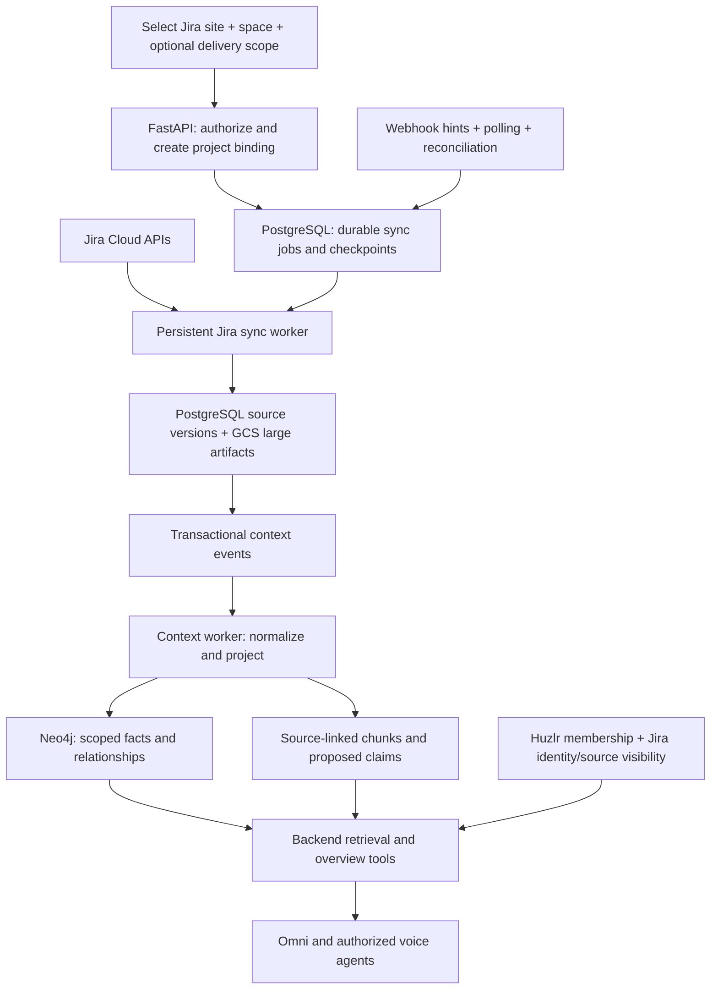

# Jira space → project context graph → agent implementation plan

Status: proposed implementation plan; no connector changes implemented by this document.

Date: 2026-10-10.

Implementation update: the core Cloud connector, durable ingestion, graph projection, personal source authorization, agent tools, import/status UI, text attachments, and optional webhook subscription/hint handling are implemented. See the [connector runbook](../../huzlr-be/docs/jira-context-connector.md) for the shipped coverage and deployment procedure. The design below remains the broader roadmap: PDF/OCR, external document adapters, shared-audience Jira grants and large-space graph benchmarks are still outside the implemented release. Verification uses real PostgreSQL/Neo4j with a fake paginated Jira provider; production tenant acceptance is pending.

Source boundary: an Atlassian/Jira Cloud space, as requested.

Destination: an explicitly selected Huzlr project, within its team and workspace.

Initial behavior: read-only Jira ingestion and evidence-backed agent answers.

## 1. Outcome and terminology

A user connects Atlassian, selects a Jira site and space, optionally selects a delivery initiative or filter inside that space, and attaches it to a Huzlr project. Huzlr imports the accessible project context, builds a graph, keeps it current, and gives text and voice agents tools to explain scope, ownership, progress, changes, dependencies, and blockers with source links.

Jira now calls its former project container a **space**. This does not introduce a new parent/child container; Atlassian Projects are a separate planning concept. The existing REST API still exposes project identifiers and project routes. Resolve the selected Jira space to its immutable API project ID. See [Atlassian's terminology announcement](https://jirareleases.atlassian.com/announcements/jira-spaces-a-new-name-that-matches-how-you-really-work).

The first release supports importing an entire selected Jira space or an explicitly bounded delivery project within it. If that delivery project is represented by an epic, higher-level work item, saved filter, component, or label, persist that selector explicitly and resolve the selected work item set. Use the selector for enumeration, updates, reconciliation and agent aggregates; show it in the coverage report. Do not invent a generic “project inside space” API or assume standard JQL recursively includes every descendant. If the source is actually an Atlassian Project, discover its linked Jira spaces through a separately validated adapter.

“All information” means **all supported, API-accessible information visible to the authorized Jira identity**, with a coverage report for omissions. Deleted source content, hidden work items, inaccessible custom fields, app-owned data, unsupported binaries, and linked external documents cannot be promised as a universal export.

An agent should be able to answer:

- What is this project trying to deliver, and what is its current scope?
- Which work items, epics, releases, and sprints make up that scope?
- Who owns each part, and which work is unassigned?
- What blocks a release, and what depends on those blockers?
- What changed since the last standup or during the last seven days?
- Which decisions or requirements are stated in descriptions and comments?
- What is missing or stale in the imported picture?

## 2. Existing foundation and changes required

This plan is based on code inspection, not proof of a live production deployment. The older general context plan contains historical gaps that have since been implemented; use the actual code as the baseline.

| Area | Reuse | Required extension |
| --- | --- | --- |
| Jira authorization | `huzlr-be/app/api/v1/endpoints/jira.py`, connection model, Fernet utility | Secure state, refresh-token rotation, site discovery, capability detection, disconnect |
| Import UI | `huzlr/components/jira-import-dialog.tsx`, `jiraSlice.ts` | Replace demo records; choose site, Jira space, destination team/project; show background progress |
| Durable context processing | `models/context.py`, `context_worker.py`, `context_enqueue` database function | Connector-specific source records, checkpoints, batch events, ingestion/indexing status |
| Graph building | `services/context_snapshot.py`, `services/context_graph.py` | Jira projection, new entity/edge types, source visibility, scalable revisions |
| Text and embedding processing | `services/context_text.py`, `services/context_enrichment.py` | ADF parser, issue/comment/history artifacts, structured custom fields, extraction versioning |
| Agent retrieval | `api/v1/endpoints/context.py` | Authorized overview, exact item lookup, filtered aggregates, dependency traversal, source detail |
| Voice agents | `huzlr-agents/src/huzlr_agents/context.py` and agent registrations | New read tools and audience authorization; retain delegated backend access |

Four existing limits require deliberate work:

1. The graph projector accepts a fixed set of labels and relationships and replaces a whole project partition in one transaction. Large Jira spaces need benchmarked batching or a staged revision strategy.
2. Issue nodes currently have short serialized text, while document artifacts receive chunking and embeddings. Jira descriptions, comments, and history need their own artifacts; truncating issue text to 2,400 characters is not a full import.
3. Search checks Huzlr workspace/project membership. That is insufficient to enforce Jira issue security or comment restrictions. External source authorization must apply to every retrieval path.
4. The context worker currently awaits optional provider enrichment before publishing the structured graph. Split structured projection and enrichment into separately tracked jobs/revisions so an embedding or extraction outage does not block imported facts.

Keep external records in dedicated connector tables. The existing Huzlr `Issue` model and property registry do not represent Jira's complete schema. An optional read-only local issue mirror can be added later, with source mappings; it must not be the only retained copy.

## 3. Architecture



Jira remains authoritative for imported Jira facts. PostgreSQL stores imported versions, permission scope, mappings, run state, and events. GCS stores large source payloads and supported attachment artifacts. Neo4j is a rebuildable graph projection. Agents receive bounded context packets through backend tools; they do not query Jira credentials or execute arbitrary Cypher.

Run ingestion outside request-driven API processes. Use a dedicated worker process, following the existing context worker pattern, with leases, heartbeat, retry scheduling, and dead-letter/manual retry handling. API requests return a job ID immediately.

## 4. Import coverage contract

| Dataset | Included information | Acquisition and completeness rule |
| --- | --- | --- |
| Space/project metadata | ID/key/name, description, type, lead, URLs, accessible relevant settings | Project discovery/detail APIs; retain unsupported settings as explicit capability gaps |
| Work items | All accessible statuses, types, parent/epic hierarchy, summary, description, assignee/reporter, labels, dates, priority, resolution, estimates, time tracking | Enhanced project-scoped JQL search, followed by detail hydration where needed; consume every returned page |
| Fields | Available field IDs, names, types, custom values, schema metadata | Discover fields; store raw values by ID and normalize known types; never hardcode story-point or sprint field IDs |
| Comments | IDs, bodies, authors, timestamps, supported thread relationships and visibility | Dedicated comment pagination; do not treat an embedded issue response as a complete comment collection |
| History | Available status, assignee, estimate, scope, release, and other field changes | Paginated changelog API or supported bulk changelog API; preserve event IDs, author, time, old/new values |
| Worklogs | Accessible time entries, authors, timestamps, descriptions and visibility | Dedicated paginated worklogs; separate watermarks when available; do not assume issue updates cover all worklog events |
| Relationships | Parents/subtasks, configured directed issue links, remote links | Preserve configured link type and inward/outward labels; classify blocking only through an explicit mapping |
| Components and releases | Components, owners when returned, versions, dates, release status, memberships | Project component/version APIs; retain both fix and affected version semantics |
| Boards and sprints | Accessible board config, relevant backlog, sprint IDs/goals/dates/states, issue membership | Jira Software endpoints; intersect returned issues with selected source scope, since boards can span spaces |
| People | Referenced account IDs, accessible display names, issue ownership roles | Discover through returned records and scoped APIs; do not import the whole directory or infer identity from names |
| Attachments | Metadata, source URLs, and supported readable content | Import metadata for all visible attachments; queue bounded text/PDF/image extraction where enabled; record unsupported/oversized failures |
| Other sources | External document references, app-owned fields, JSM/JPD-specific entities, archived items | Detect and report. Product-specific APIs and Confluence content require separate capabilities and implementation |

Use [enhanced issue search](https://developer.atlassian.com/cloud/jira/platform/rest/v3/api-group-issue-search/) with `nextPageToken`, not the legacy `/search` route. Search may lag recent changes, so an initial import needs a catch-up pass rather than a claim of an atomic source snapshot. Comments and changelogs have [separate APIs](https://developer.atlassian.com/cloud/jira/platform/rest/v3/api-group-issues/); permissions can differ across source types. [Board APIs](https://developer.atlassian.com/cloud/jira/software/rest/api-group-board/) require endpoint-specific Jira Software scopes in addition to the basic connection.

Store a coverage manifest per binding and run:

```text
dataset; required/optional; capability; pages_completed; records_imported;
last_checked_at; source_watermark; retry_count; exclusions; error_category;
status = pending | running | complete | partial | unavailable | not_applicable
```

Distinguish “zero accessible records” from “request failed” and “not supported.” Report completeness relative to the selected identity and source scope, never the entire organization's hidden data. Search counts that are approximate are diagnostic only; acceptance uses a stable test fixture or verified accessible inventory.

Default history policy: import all accessible completed and active work in the selected space, plus accessible comments, changelogs and worklogs. For a very large source, users may explicitly choose a limited-history profile; the UI and agent must expose the cutoff. Optional attachment extraction can finish after core records, but full coverage is not marked complete while enabled required work remains pending.

## 5. Data model and source identity

Add migrations for these proposed tables (names can follow repository conventions):

| Table | Purpose and constraints |
| --- | --- |
| `jira_connections` extension | Atlassian account identity, encrypted rotating credentials, token version, connection health; migration from existing user connection without losing tokens |
| `jira_sites` | Accessible cloud ID, site URL/name, capabilities and last discovery time, bound to the connection |
| `jira_project_bindings` | Workspace/team/Huzlr project, site/cloud ID, immutable Jira project ID, current key, selector, history policy, source identity, lifecycle and permission epoch |
| `jira_sync_runs` / `jira_sync_tasks` | Run manifest, task type/partition, cursors, leases, heartbeat, attempts, failure categories, published revision |
| `jira_source_objects` / `jira_source_versions` | Current normalized object and retained version evidence; binding, source type/ID, provider timestamp, content hash, fetch sequence, visibility, deletion/access state |
| `jira_source_mappings` | Optional source-to-Huzlr entity mappings, scoped by destination; database uniqueness prevents duplicate mirrors |
| `jira_access_views` | Per-user/source visibility grants, verified time, permission epoch, audience and expiry; no implicit inheritance from an importer's access |

Use immutable provider IDs for identity:

```text
source ID: jira:{cloud_id}:issue:{numeric_issue_id}
source ID: jira:{cloud_id}:comment:{comment_id}
source ID: jira:{cloud_id}:project:{numeric_project_id}
projection ID: huzlr:{workspace_id}:{huzlr_project_id}:{source_id}
```

Keys and names are mutable display attributes. An issue rename or move must not create a new entity. Keep the old/new membership in evidence and re-evaluate whether it belongs in the selected scope. Numeric IDs are site-qualified.

The graph currently enforces global `canonical_id` uniqueness. Use the destination-qualified projection ID there, and retain the stable source ID separately. This permits the same external record to be attached to two authorized Huzlr project partitions without one projection replacing the other. Referenced people/components/sprints are likewise partition-qualified. Agents receive both identifiers and an exact source URL.

Retention is configurable at workspace level. Disconnect immediately blocks retrieval and schedules deletion or retention processing according to the selected policy. Retained raw evidence remains inaccessible to agents; purges also cover embeddings, derived claims, summaries, source artifacts, and conversation caches.

## 6. Authorization and connection lifecycle

1. Replace numeric-user OAuth `state` with a cryptographically random, one-use value stored server-side, bound to the initiating authenticated user, target workspace, and short expiry. Validate and consume it on callback; reject mismatch/replay before storing credentials.
2. Discover authorized sites and account identity after exchanging the code. Validate configured scopes and capabilities before enabling each dataset. Remove unconditional Jira issue write permission for the read-only release; maintain an endpoint-to-scope matrix for enabled reads and webhook registration.
3. Implement serialized refresh-token rotation with a connection lock/token version. Atomically store newly returned credentials and expiry. Treat revoked grants as `needs_reconnect`; do not keep a healthy connection badge solely because a row exists.
4. Check Huzlr workspace/team/project access on connect, bind, sync, search, detail, visualization, disconnect, and retry. Resolve destination IDs server-side; remove the hardcoded team ID.
5. Default source access is personal: an imported source is usable only by the matching verified Jira identity and authorized Huzlr user. A teammate connecting Jira must establish their own accessible view. Do not expose the importer's cache based only on Huzlr membership.
6. Enforce issue, comment, worklog and attachment visibility. Use live provider visibility checks for evidence selected for an answer, including restricted subresources; cached source records are candidates, not permission proof. If a provider cannot verify a requested source, omit it or fail closed. Recheck authorization before emitting an answer.
7. Apply source-access predicates before ranking, neighbor traversal and aggregation; both endpoints of an edge must be readable. For project-wide aggregates, refresh the accessible inventory for that identity or label the result as an explicitly time-bounded verified view; checking only the few cited issues is insufficient. All claims/chunks inherit source restrictions; summaries inherit the intersection of their evidence permissions. Cache keys include user/view, permission epoch, binding and source revision.
8. On revocation or inaccessible records, invalidate the affected access view, sessions, summaries and retained chat context immediately when detected. Never pass old cited turns back into a model after their source authorization becomes invalid. Declare any permission-check freshness window explicitly.
9. A shared meeting needs an authorized audience, not just the meeting organizer's personal Jira access. Use the intersection of verified participant views or a deliberately approved shared source view. Until that audience boundary is implemented, restrict Jira context to private text/voice sessions; do not read personal Jira evidence into meetings.

The existing authenticated Huzlr session/delegation layer remains useful, but must be extended with external access-view identity. [Atlassian OAuth guidance](https://developer.atlassian.com/cloud/jira/platform/oauth-2-3lo-apps/) requires user-bound, unguessable state and describes site discovery and rotating refresh tokens. [Comment visibility](https://developer.atlassian.com/cloud/jira/platform/rest/v3/api-group-issue-comments/) is an additional authorization boundary beyond issue visibility.

Live checks have a latency and API cost. In the pilot, favor correct disclosure over aggressive caching and benchmark it. Provider permission changes during an in-flight request cannot be made atomic with Huzlr; document that boundary and ensure detected revocation prevents subsequent reads. Shared summaries and native project fields must never silently absorb restricted Jira content.

## 7. Initial import and ongoing synchronization

### Initial run

1. Authorize destination and source; resolve site/space IDs and selected delivery scope. Record capability matrix, source start time and run manifest.
2. Fetch project metadata, field schema, components and versions. Detect hierarchy, status and custom-field mappings for this space.
3. Enumerate every accessible work item in scope using deterministic project-bounded JQL. Follow provider-issued cursors; upsert by stable ID and deduplicate across pages.
4. Hydrate descriptions, custom fields, links and ownership. Enqueue separate tasks for comments, changelogs, worklogs, relevant boards/sprints and enabled attachment content.
5. Commit each fetched batch, normalized data, source versions, checkpoint and context event in one SQL transaction. Advance the cursor only after successful persistence. Use leases and resumable per-dataset tasks.
6. Re-read changes since the run's start using an overlap window, then reconcile accessible inventory. Source updates can occur during pagination; do not treat pagination as a point-in-time snapshot. Define a latest-consistent published source revision.
7. Queue graph projection and enrichment for committed source revisions. Mark the UI `core_ready` only when core datasets and their graph projection match; mark the declared full coverage ready separately.

For an expired cursor, restart the bounded partition/window with idempotent upserts. A failed comments task must not force a re-download of all issues. Different source types can progress independently; a partial result must be visible to the agent as partial.

### Continuous updates

- Start with configurable incremental polling (pilot target: every 5 minutes) using a stable upper bound and an overlap window on provider update time. Advance a watermark only after all pages and required hydration tasks for that window commit.
- Add supported project-scoped webhooks as a latency improvement. Persist and deduplicate receipts; acknowledge after durable queueing, then re-fetch canonical records under the bound identity. Treat payloads as change hints, not authoritative graph writes.
- Authenticate dynamic OAuth webhook deliveries by validating their bearer JWT with the app client secret using a maintained library and the documented token contract. Reject invalid deliveries before queueing. HMAC support for admin webhooks is a different mechanism. Validate the registered source binding and event type, rate-limit the receiver, and never install webhook payload data or assert deletion without an authorized canonical re-fetch.
- Dynamic webhook JQL supports only selected clauses; sprint/version notifications are not filtered by that JQL. Apply the selected space/delivery boundary again in the worker and share registrations within provider limits rather than registering once per arbitrary selector. Verify supported events/scopes during the capability spike.
- Track webhook ownership, expiry and renewal; [dynamic webhook registrations expire after 30 days](https://developer.atlassian.com/cloud/jira/platform/webhooks/). Retain polling and scheduled reconciliation for missing events and non-covered metadata/history changes.
- Reconcile inventory and metadata on a configurable schedule (initial target: nightly), plus targeted rechecks for deletions, scope moves, restricted content, and inaccessible resources. A missing search result or `404` is not sufficient proof of deletion; suppress access immediately, then classify deleted/moved/inaccessible using authorized evidence.
- Serialize changes to the same source object or use version/fetch-sequence checks so a delayed task cannot overwrite a newer fetch. Do not order all object types using one issue timestamp.
- Honor `429`, `Retry-After`, and applicable rate-limit headers with jitter and adaptive per-site/per-endpoint concurrency. Follow [Jira's current rate-limit guidance](https://developer.atlassian.com/cloud/jira/platform/rate-limiting/); do not hardcode a quota assumption.

Keep separate timestamps for last successful provider fetch, dataset coverage, source revision, graph-applied revision, enrichment revision and permission verification. “Graph indexed recently” does not mean Jira was synchronized recently.

## 8. Graph schema and extraction policy

Extend graph allowlists and projector validation deliberately. Every projected record carries destination scope, source ID/type, source version, source URL, timestamps, binding ID, access-view metadata and active/tombstoned status.

| Node | Examples of relationships |
| --- | --- |
| `JiraSpace`, existing `Project` | Project `IMPORTS_FROM` JiraSpace; JiraSpace `HAS_ISSUE` Issue |
| `Issue` with source issue type | `SUBTASK_OF`, `CHILD_OF`, `BLOCKS`, `RELATES_TO`, `DUPLICATES` |
| `Person` | Issue `ASSIGNED_TO` Person, `REPORTED_BY` Person; Comment `AUTHORED_BY` Person |
| `Sprint`, `Board` | Issue `IN_SPRINT` Sprint; Sprint `ON_BOARD` Board; record membership timing |
| `Version`, `Component` | Issue `TARGETS_VERSION` Version, `AFFECTS_VERSION` Version, `IN_COMPONENT` Component |
| `Comment`, `ChangeEvent`, `Worklog`, `Attachment` | Issue `HAS_COMMENT`, `HAS_CHANGE`, `HAS_WORKLOG`, `HAS_ATTACHMENT` |
| `DocumentChunk`, existing `Claim` | Source `HAS_CHUNK` Chunk; Claim `SUPPORTED_BY` source evidence |

Epics and configurable higher-level issue types use the Issue hierarchy, not duplicated unrelated entities. Preserve custom relationship types in structured metadata; use a supported generic typed-link representation for unmapped types. Explicit links determine dependency edges. Similar text is not evidence that two issues block each other.

Cross-space dependencies are reported only when both source objects and their destination contexts are authorized. For a link leaving the selected scope, preserve a restricted internal reference and expose a boundary indicator only if the referring source permits it; do not fetch the other project's content automatically or reveal its title.

Structured Jira fields become sourced facts without an LLM. Parse [Atlassian Document Format](https://developer.atlassian.com/cloud/jira/platform/apis/document/structure/) into readable text while preserving headings, lists, tables, mentions, links and source offsets. Keep original payloads and parser version; the current JSON serialization helper is not an ADF parser.

Chunk issue descriptions, comments and attachment text with their own source identity. Embed readable content and index identifiers/custom-field values for exact lookup. Extract requirements, decisions, risks and narrative blockers only as evidence-linked proposed claims. A statement in a comment does not override Jira's current status. Supersede claims on source edits/deletions, retaining accessible history according to retention policy.

For projection publication, begin with the existing revision guard for a measured small pilot. Debounce batches to avoid rebuilding once per issue. Before supporting the scale target, add staged graph generations or incremental entity upserts with tombstones and monotonically increasing source revisions. If using generations, readers select the published generation; stale writers cannot publish over a newer one, and garbage collection cleans superseded generations. Native and Jira data must remain in the same coherent authorized project view.

## 9. Agent access: overview plus evidence tools

The agent's “picture” should be a compact, permission-scoped overview plus retrieval tools, not an attempt to place the entire Jira space into a prompt.

Add shared backend read operations, reused by Omni and delegated agent sessions:

| Tool | Behavior |
| --- | --- |
| `get_project_overview` | Accessible scope, status counts, ownership gaps, selected sprint/release state, known dependency summary, recent changes, freshness and missing datasets |
| `get_work_item` | Exact immutable ID/key lookup with structured facts, source link and bounded evidence; supports pagination of source detail |
| `search_project_context` | Extend existing lexical/semantic search with filters for status, owner, issue type, date, sprint, release and source; filter access before ranking |
| `trace_dependencies` | Bounded directed traversal for blockers, parents and dependents, returning cited paths and explicit boundary/truncation indicators |
| `get_recent_changes` | Deterministic accessible change events within a requested window; compare estimate/scope/status changes without inventing historical snapshots |
| `get_source_evidence` | Retrieve authorized description/comment/history chunks by source ID/version; no arbitrary URL fetch |

An overview uses aggregates over the full authorized source set, not counts inferred from search's top results or the visualization limit. Restricted or partial views must say “visible work items.” Qualitative summaries cite evidence and invalidate when referenced sources or visibility change. Do not rank arbitrary partial aggregates as globally definitive.

At session start fetch a small overview, then retrieve only evidence relevant to each question. Use backend query templates; no agent-generated Cypher. Enforce configured limits on nodes, traversal depth, result pages, response tokens and model latency. Return `truncated` and `next_cursor` where needed instead of silently pretending a limited answer is complete.

Every packet returns: authorized scope; facts; relationships; source citations and versions; source sync time; graph/enrichment revisions; missing datasets; view identity; and truncation. Agent instructions require distinguishing current Jira facts, historical events, proposed claims and model interpretations. A release-risk statement should explain the underlying evidence; a graph alone does not establish a predictive risk model.

Example acceptance interaction:

> “What blocks release 2.4?” → the agent gets the authorized release overview, traverses configured blocking links, opens the relevant issues and recent comments, and returns a cited dependency path, owner, current status and source sync time. If comment import is incomplete, it states that limitation.

## 10. API and user experience

Proposed public API routes under `/api/v1/jira`:

```text
GET    /sites
GET    /sites/{site_id}/spaces                 # map to provider project discovery
GET    /sites/{site_id}/spaces/{space_id}/capabilities
POST   /bindings                              # destination and source selector
GET    /bindings/{binding_id}
POST   /bindings/{binding_id}/sync             # returns run ID, HTTP 202
GET    /bindings/{binding_id}/runs/{run_id}
GET    /bindings/{binding_id}/coverage
DELETE /bindings/{binding_id}
DELETE /connections/{connection_id}
POST   /webhooks/{registration_id}             # bounded queue-only receiver
```

All route identifiers resolve through server-side ownership checks. Destination workspace/team/project cannot be substituted through a client-supplied ID. Public mutation routes cover Huzlr connection/binding lifecycle only; this release performs no Jira issue writes.

User flow:

1. Connect Atlassian and select one authorized site.
2. Choose a Jira space and optional delivery scope. Show what datasets are supported and what requires additional access.
3. Attach to an existing Huzlr project or create one in the active authorized team; choose history/attachment options.
4. Run import in the background. Show counts and phases: discovering → importing core → importing history/content → indexing → core ready/full coverage ready, with partial/reconnect/error states.
5. Inspect imported context and source coverage; launch the agent against that project. Let the user retry a failed dataset or request resynchronization.

Remove fake Jira projects, statistics and milestones. Preserve failed-import state visibly rather than closing the dialog as if successful. Graph exploration needs type/source filters and pagination; the existing 500-node visualization is a bounded view, not a coverage report.

## 11. Delivery milestones and estimates

Planning estimate: **24–36 engineering days, roughly 5–8 weeks for one experienced engineer**, assuming development credentials, a representative Jira test site and working PostgreSQL/Neo4j/GCS infrastructure. These are implementation estimates, not delivery promises; deployment readiness, access approvals, large-source performance and product-specific adapters can extend them. Attachment OCR and separately linked Confluence/JSM/JPD/app data are estimated after the capability spike.

| Milestone | Estimate | Deliverable | Exit gate |
| --- | --- | --- | --- |
| 1. Source scope and secure connection | 3–5 days | Confirm space/selector semantics, OAuth security, renewal, sites, capability/scopes matrix, binding/access-view migrations | State replay rejected; credential rotation race handled; live site/space discovery; revoked grant blocks use |
| 2. Durable complete importer | 5–7 days | Background tasks, raw/versioned storage, complete core/history datasets, source mappings and coverage UI | Stable accessible fixture reconciles; worker interruption resumes; repeated imports create no duplicates; partial datasets stay explicit |
| 3. Graph and evidence projection | 4–6 days | Structured Jira entities/edges, ADF artifacts, embeddings/claims, source/access metadata, graph status | Dependency directions/hierarchy correct; source edits invalidate claims; two destination bindings do not collide; rebuild from retained sources succeeds |
| 4. Agent picture and access boundary | 5–7 days | Overview, exact lookup, typed traversal, evidence tools, Omni/private voice integration | Cited evaluation passes; inaccessible issues/comments never appear through search, overview, graph, summaries or old chat history |
| 5. Reliable updates and scale | 4–6 days | Polling, tested webhook hints/renewal, deletion/access handling, reconciliation, staged/incremental projection where required | Missed/duplicate/out-of-order events converge; failed batches do not advance watermarks; rate limits pause safely; scale test meets agreed budget |
| 6. Operational pilot and rollout | 3–5 days | Dashboard metrics, runbooks, controlled real-space pilot, feature flags, rollback/purge verification | Pilot coverage sign-off; correct sample agent answers; measured sync/latency/cost; recovery and disconnect tested |

Dependencies: 1 → 2 → 3 → 4; reliable updates build on durable ingestion and graph revisions; production rollout waits for milestone 5. A private, manual-sync demonstration is possible after milestone 4, but is not yet the continuous production connector. Shared meeting use has its own audience authorization exit gate and is disabled until it passes.

## 12. Tests and measurable acceptance

Use a controlled Jira fixture and sanitized provider payloads with: company-managed and team-managed spaces; nonstandard custom fields/statuses; multiple boards; a board spanning spaces; parent/epic/subtask chains; directed blocking links and cycles; restricted issues/comments/worklogs; >1 page of comments/history; deleted/moved issues; and separate users with different access.

Required connector/integration checks:

- Import all accessible fixture IDs and all enabled subresource pages. Unknown custom fields retain their IDs, schema and original values. No silent row/field/text loss.
- Replay initial and incremental runs without duplicates; crash between fetch and commit and between commit and graph application; verify safe resume and unchanged checkpoints on failure.
- Simulate `401`, revoked refresh grant, rotating refresh race, `403/404`, `429`, timeout, expired cursor, delayed indexing, webhook renewal failure, and duplicate/out-of-order events.
- Rename keys, move an issue across source boundaries, delete comments, revoke access, and edit description text. Verify current facts, claims, summaries and embeddings converge correctly.
- Test three authorization dimensions separately: wrong Huzlr workspace/team; authorized Huzlr member lacking Jira access; authorized Jira issue reader lacking restricted comment access. Verify every tool, aggregate, visualization and conversation cache.
- Rebuild the Neo4j project view from SQL/GCS without calling Jira, while preserving authorization restrictions and citations. Then reconcile with Jira to establish freshness.
- Test shared meetings with mixed source access and participant changes; default deny until audience verification succeeds.

Agent evaluation: create 30 manually checked questions covering exact lookup, scope/status totals, ownership, hierarchy, blockers, release readiness, recent changes, custom fields, conflicting comments, missing data and access boundaries. Require at least 90% reviewer-accepted factual answers, valid citations for every material Jira assertion, and zero unauthorized disclosures on the adversarial suite. Deterministic counts/relationships must match the fixture exactly. Keep proposal/model interpretation separate from a sourced fact.

Pilot performance targets to measure, not assumed current capabilities:

- Current-state polling converges within 10 minutes under ordinary load; webhook-supported updates target 2 minutes. Rate-limited periods are reported as delayed.
- Backend cached overview retrieval p95 ≤2 seconds, authorized evidence/search p95 ≤5 seconds including provider visibility checks, excluding model generation. Voice tool deadlines stay within the current 35-second HTTP envelope.
- Benchmark a source with 10,000 work items and at least 100,000 combined comments/history/worklogs, plus a small source. Record import duration, API calls, memory, graph transaction time, embedding/extraction cost and recovery duration. Set the supported production ceiling from results; no “unlimited” claim.
- Structured graph readiness does not depend on optional LLM extraction succeeding. Failed enrichment is retryable and visible without losing sourced structured facts.

Instrument run duration, datasets/pages/records, API retry categories, connection health, sync lag, pending graph revisions, embedding spend, permission-check failures, retrieval latency and citation validity. Do not log tokens or source bodies in operational logs.

## 13. Concrete implementation work packages

1. **Connection and scope:** update Jira endpoint/model; add migrations and `schemas/jira.py`; add `services/jira/oauth.py`, `client.py`, `capabilities.py`, `access.py`; document environment/scopes and run focused OAuth tests.
2. **Ingestion:** add connector persistence models, `jira_worker.py`, `services/jira/sync.py`, per-dataset fetchers and durable task leasing; add fixtures, pagination/replay/recovery tests and coverage routes.
3. **Projection:** add `services/jira/normalize.py`, `projector.py`, `adf.py`; extend context snapshot, graph allowlists and enrichment; explicitly enqueue changed connector batches because existing native table triggers do not cover new source tables.
4. **Agent tools:** extend context schemas/endpoints/access filtering, overview and dependency queries; register tools in the shared agent module; test private text and voice sessions before meeting exposure.
5. **Frontend:** replace `jiraSlice.ts` mocks and import dialog mapping; use active destination scope, background runs, dataset coverage and error/retry controls; expose source freshness in agent answers and project context.
6. **Operations:** worker deployment, scheduler, feature flags, migrations, graph constraint migration, credentials, observability, reindex/reconcile procedures, pilot and purge/recovery runbooks.

Maintain a capability/coverage matrix as part of the connector contract. Add adapters for Confluence documents, Atlassian Projects, JSM/JPD-specific context and app-owned data only when the chosen source requires them, with explicit acceptance tests and revised estimates. Jira write-back remains a separate milestone after read completeness, source authorization and convergence are proven.
