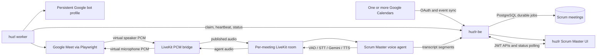

# huzl Architecture



## Ownership Boundaries

- `huzlr` owns user controls and display state.
- `huzlr-be` owns authorization, Calendar tokens, policy, scheduling, audit state,
  transcripts, and LiveKit agent execution.
- `huzl` owns one active browser/audio session and contains no user JWT or Calendar
  refresh token.
- Google OAuth identity and the dedicated Meet browser identity are separate.
- Calendar connections are unique per workspace and Google account email; syncing
  without a connection ID processes every connected account.

## Meeting Lifecycle

```text
scheduled -> queued -> starting -> authenticating -> waiting_for_admission
          -> joined -> leaving -> completed

Any active state -> cancelled
Any active state -> failed
Stale heartbeat -> queued retry, maximum three attempts
```

`Join now` is idempotent while a job is active. Clicking a Meet join control is not
treated as admission; `joined` requires the in-call leave control. Cancellation is
stored in PostgreSQL and returned with the next five-second worker heartbeat.

## Audio Contract

The Meet side uses signed 16-bit, 16 kHz, mono PCM. Capture publishes frames into
LiveKit. Remote agent frames are requested from LiveKit at the same format and fed to
the injection queue. Partial output frames are retained instead of discarded.

## Deployment Gate

The code path is complete enough for controlled integration testing, not unattended
production. Production enablement requires real credentials, an encrypted persistent
profile volume, migration application, disclosure/retention approval, and successful
live-meeting reliability tests.
