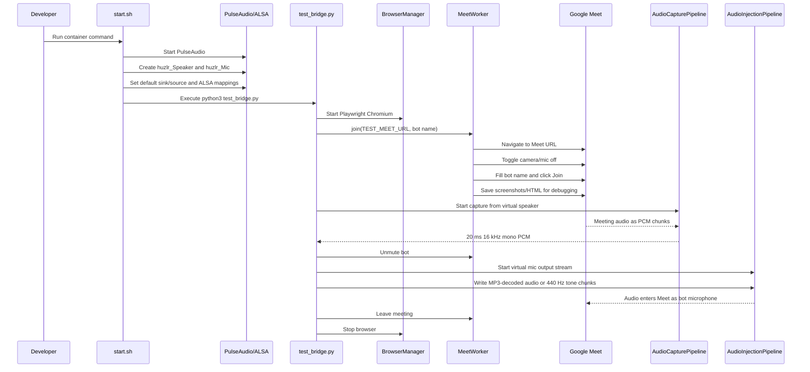

 # huzl Architecture

## System Diagram

```mermaid
flowchart LR
    Operator[Developer / Orchestrator] -->|docker run / python3 test_bridge.py| Runtime[huzl Runtime]

    subgraph Container["Docker / Linux Audio Runtime"]
        Runtime --> Startup[start.sh]
        Startup --> Pulse[PulseAudio daemon]
        Startup --> ALSA[/etc/asound.conf]
        Pulse --> Speaker[huzlr_Speaker null sink]
        Pulse --> Mic[huzlr_Mic null sink]

        Runtime --> BrowserManager[bridge/browser_manager.py]
        BrowserManager --> Chromium[Playwright Chromium]
        Chromium --> Meet[Google Meet]

        Runtime --> MeetWorker[bridge/meet_worker.py]
        MeetWorker -->|join, mute, unmute, leave| Chromium

        Meet -->|meeting audio output| Speaker
        Speaker -->|monitor input| Capture[bridge/audio_capture.py]
        Capture -->|16 kHz mono PCM chunks| AgentLayer[Agent / Test Logic]

        AgentLayer -->|16 kHz mono PCM chunks| Injection[bridge/audio_injection.py]
        Injection -->|output stream| Mic
        Mic -->|virtual microphone input| Chromium
        Chromium -->|bot speech/audio| Meet
    end

    subgraph AI["Agent Layer, Partly Scaffolded"]
        Conversation[agent/conversation_manager.py]
        Interruptions[agent/interruption_manager.py]
        Gemini[agent/gemini_runtime.py]
        LiveKit[agent/livekit_agent.py]
        ProjectTools[tools/project_tools.py]
    end

    Capture -.future orchestration.-> Interruptions
    Interruptions -.state events.-> Conversation
    Conversation -.prompt context.-> Gemini
    ProjectTools -.tool context.-> Gemini
    Gemini -.text response.-> AgentLayer
    LiveKit -.alternative voice stack.-> AgentLayer
```

## Runtime Sequence



## How It Works

`huzl` is built around one core trick: Google Meet is controlled by a browser, but the bot's ears and mouth are virtual audio devices.

The browser joins the meeting through Playwright. `BrowserManager` launches Chromium with media-permission flags, and `MeetWorker` performs the Google Meet UI actions: open the meeting URL, turn off mic/camera, enter the bot name, click join, detect whether the call is active, unmute, mute, and leave.

The audio path is handled outside the browser. `start.sh` starts PulseAudio and creates two null sinks:

- `huzlr_Speaker`: used as the meeting audio output path. The capture pipeline listens to its monitor stream.
- `huzlr_Mic`: used as the bot microphone path. The injection pipeline writes audio into it.

`AudioCapturePipeline` reads incoming meeting audio as 20 ms, 16 kHz, mono PCM chunks. This is the shape most realtime speech systems expect.

`AudioInjectionPipeline` writes 20 ms, 16 kHz, mono PCM chunks into the virtual microphone. In the current smoke test, those chunks come from either `arabic_ringtone.mp3` decoded by `ffmpeg` or a generated 440 Hz tone.

The AI agent pieces are present but not fully wired into the bridge loop yet. `GeminiRuntime` can generate streamed text responses, `ConversationManager` tracks states like listening/thinking/speaking/interrupted, `InterruptionManager` does simple RMS-based voice activity detection, and `livekit_agent.py` sketches an alternate LiveKit-native voice assistant using Silero, Deepgram, Gemini, and ElevenLabs.

## Current Practical Flow

Today, the most concrete path is:

1. Build/run the Docker image.
2. `start.sh` prepares virtual audio.
3. `test_bridge.py` joins a Google Meet.
4. The script captures meeting audio and logs signal level.
5. The script unmutes the bot and injects test audio.
6. The script leaves the meeting and shuts down the browser.

## Intended Future Flow

The likely production shape is:

1. Capture meeting audio from `AudioCapturePipeline`.
2. Run VAD/interruption detection on each PCM chunk.
3. Send speech audio to STT.
4. Feed transcript plus project context/tools to Gemini.
5. Convert Gemini's response to speech with TTS.
6. Stream TTS PCM chunks into `AudioInjectionPipeline`.
7. Clear the injection queue when an interruption is detected.

## Boundaries

- `bridge/*`: browser automation and raw audio IO.
- `agent/*`: conversation state, AI model calls, interruption logic, and voice orchestration.
- `tools/*`: project-management context/actions for the agent.
- `test_bridge.py`: integration smoke test, not the final production orchestrator.
